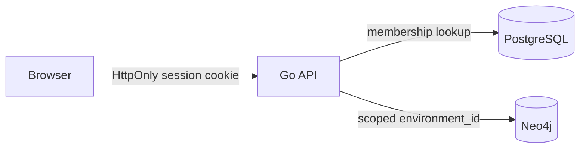

# Authentication and tenant boundaries

PostgreSQL owns accounts, organizations, environment metadata, memberships, sessions, and audit records. Neo4j owns assets, vulnerabilities, and graph relationships. The stable `environment_id` joins these ownership domains at the Go API boundary.



The local demo seeds two isolated organizations: Northstar Financial and Harbor Labs. Each has a separate admin account; Northstar also has a viewer account. The Harbor graph starts empty. A signed-in user lists only assigned environments. Every graph, asset, vulnerability, relationship, transition, and path request checks environment membership. Writes require `editor` or `admin`. A user without membership receives 404, avoiding environment enumeration.

Passwords are stored as bcrypt hashes. Login issues a random opaque 256-bit token; PostgreSQL stores only its SHA-256 hash. Cookies are `HttpOnly`, `SameSite=Strict`, scoped to `/api`, and expire after eight hours. Set `COOKIE_SECURE=true` behind HTTPS. Login attempts are limited to ten per minute per client IP in this single-process local service. State-changing browser requests enforce same-origin when an `Origin` header is present. Successful authenticated mutations produce audit records. Secret values are read from environment variables.

## Provision a non-demo organization

Set `DEMO_MODE=false` in `.env` before starting a fresh stack. The API then creates constraints but does not seed demo users or the Northstar graph. Set `PROVISION_ORG_NAME`, `PROVISION_ENV_NAME`, `PROVISION_EMAIL`, and `PROVISION_PASSWORD` in the operator's shell, then run:

```bash
docker compose run --rm --no-deps -e PROVISION_ORG_NAME -e PROVISION_ENV_NAME -e PROVISION_EMAIL -e PROVISION_PASSWORD api /provision bootstrap
```

The command returns generated organization, environment, and admin IDs. It runs PostgreSQL migrations and creates all four records atomically; if the email already exists, nothing is created. The password must be 12 to 128 bytes. Clear `PROVISION_PASSWORD` from the shell afterward. Do not put real passwords in command arguments, `.env`, or source control. Run the command again with a different email to create a separate organization. On an existing volume that already contains demo data, switching `DEMO_MODE` off stops future seeding but does not erase old records; use a fresh volume for an isolated non-demo deployment.

An organization administrator can list its users, create new accounts with `viewer`, `editor`, or `admin` roles, and create empty environments through the **Organization access** panel. New accounts are unique by email across the database; they receive access only to their assigned organization. The app does not email credentials. Share initial passwords through an approved channel and have users change them on first sign-in. Users can change their own password in the header; all existing sessions are revoked.

To rotate a password in a persisted volume, including a local demo account, set `PROVISION_EMAIL` and a new `PROVISION_PASSWORD` in the operator's shell and run:

```bash
docker compose run --rm --no-deps -e PROVISION_EMAIL -e PROVISION_PASSWORD api /provision rotate-password
```

This updates the bcrypt hash and revokes every session for that account. Changing `DEMO_PASSWORD` in `.env` alone does not update existing hashes because demo seeding preserves existing users.

Before public deployment, add HTTPS termination, a shared rate limiter for multiple API replicas, scheduled session expiry cleanup, strict trusted-proxy configuration, and a CSRF token strategy if cookie settings or deployment origin policy change. Do not expose the demo credentials publicly.

## Validation

`tests/integration_relationships.ps1` checks unauthenticated denial, separate tenant environment lists, cross-tenant read and write denial, viewer read and write behavior, relationship preconditions, and saved graph positions. It uses synthetic records and removes them after the run.

`tests/integration_provisioning.ps1` bootstraps a temporary organization, checks admin and viewer boundaries, changes a password, resets the admin password through the operator command, verifies old sessions and passwords are rejected, and removes its test records.
