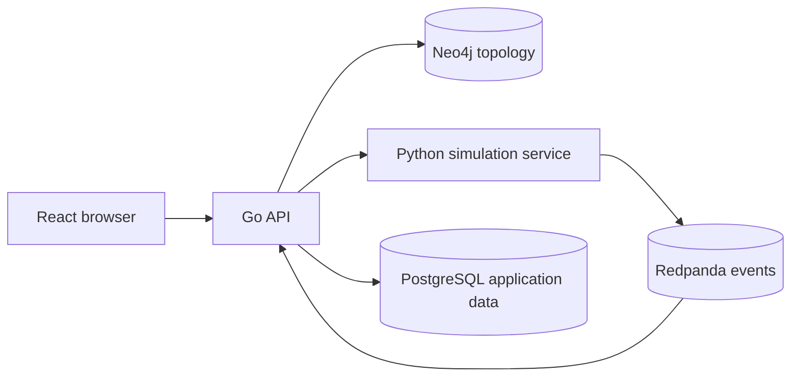

# AttackGraph implementation plan

## Architecture and ownership

The Go API owns public contracts, authentication, tenant checks and orchestration. Neo4j owns synthetic assets and typed relationships. PostgreSQL owns accounts, organizations, environment metadata, memberships, sessions, audit records, versioned graph snapshots, simulation runs and jobs, telemetry, rules, and alerts; it will later own reports. Python owns path algorithms and simulations. All cross-service entities use stable string IDs. Every run references an immutable graph snapshot so later edits cannot change its inputs.

## Initial graph model

`Asset` nodes have `id`, `environment_id`, `name`, `type`, `segment`, `criticality`, `risk`, and synthetic `ip`. `Vulnerability` nodes are linked by `CONTAINS_VULNERABILITY` and have `active` or `mitigated` lifecycle state. `TRANSITION` relationships are modeled adversary steps, separate from `CAN_REACH` and `HAS_ACCESS_TO` topology. A transition includes `reason`, `likelihood`, `required_capability`, `grants_capability`, `required_relationship`, `vulnerability_id`, and `blocked`. Traversal requires the capability, matching topology or access relationship, enabled transition, active source weakness, and matching environment. No real host operations occur.

## Initial API contract

- `GET /api/v1/health` returns service status.
- `GET /api/v1/environments` lists environments.
- `GET /api/v1/environments/{id}/graph` returns assets and relationships.
- `POST /api/v1/attack-paths/analyze` accepts `environment_id`, `start_asset_id`, `target_asset_id`, `max_depth`; returns feasible paths with reasons and model estimates.
- `POST /api/v1/environments/{id}/assets` creates a synthetic asset; `PATCH /api/v1/environments/{id}/assets/{assetID}` edits it.
- `PATCH /api/v1/environments/{id}/assets/{assetID}/position` saves graph coordinates in Neo4j.
- `GET/POST /api/v1/environments/{id}/vulnerabilities` lists or creates weaknesses; `PATCH /api/v1/environments/{id}/vulnerabilities/{vulnerabilityID}` edits one.
- `PATCH /api/v1/environments/{id}/transitions/{transitionID}` changes its modeled blocked state.
- `POST /api/v1/environments/{id}/relationships` creates a validated topology or access edge. `POST /api/v1/environments/{id}/transitions` requires a matching edge and a vulnerability owned by the source asset.

Errors use `{ "error": { "code": string, "message": string } }`. Inputs have bounded lengths and depth. IDs are scoped to the environment.

## Current risk model

Asset exposure is a synthetic ranking from 0 to 100, recomputed on graph reads. The unclamped score is `0.35 × max asset CVSS × 10 + 8 × criticality + 2 × incoming CAN_REACH count + 12 × incoming DMZ reachability + 3 × unblocked outgoing transitions + 2 × highest downstream criticality − 6 × blocked outgoing transitions`. The result is rounded and clamped to 0–100. This transparent heuristic has no empirical calibration; the path score separately multiplies configured transition estimates and scales by target criticality. Editing a vulnerability changes asset exposure but does not silently create an attack transition. Mitigation removes its transitions from path results and risk scoring.

## Phases

1. **Implemented vertical slice:** Compose, seeded Northstar graph, Go API, Python path analysis, interactive React graph, path reasoning, unit tests and documentation. Validated with a live graph fetch and path analysis through Go.
2. **In progress:** Asset and vulnerability editing, identity model and graph views. PostgreSQL migrations, local demo authentication, membership checks and cross-tenant denial are implemented. Asset/vulnerability editing, relationship creation, transition blocking and saved node coordinates work. Operator bootstrap, admin account/environment creation, and password rotation are implemented. Richer identity nodes remain open. Named layouts, isolated position edits, and deterministic auto arrangement are implemented.
3. **Implemented slices:** Delivered synthetic telemetry, an event explorer, declarative detection rules, alerts, and an aggregate SOC overview. Delivery and ingestion use persisted cursors and database uniqueness constraints. A broker, correlation, and ATT&CK mapping remain open.
4. **Implemented slices:** Paired seeded Monte Carlo defense comparison with uncertainty intervals, plus on-demand run investigation reports and JSON export. Comparison is synchronous and reports are generated from saved runs rather than stored as independent documents.
5. Remaining: Redpanda delivery, richer graph and identity model, correlation and coverage metrics, queued Monte Carlo jobs, observability, and full end-to-end coverage.

Snapshot capture now takes a per-environment Neo4j write lock before reading assets, edges, and weaknesses in one transaction. All API graph mutations use the same lock. Direct Neo4j writes bypass the protocol; deployments must restrict direct graph writes or make them take the lock.

Every later phase must replace this plan's open items with verified behavior. No UI route should imply an unfinished capability works.

## Continuation after the current slice

1. Add Redpanda-backed synthetic telemetry and a consumer while preserving the database cursor and idempotent ingestion contract. Generation remains synchronous and bounded; backend jobs deliver an already computed timeline.
2. Add a live telemetry event stream, richer explorer filters, and time-series SOC charts. The current SOC overview is polled aggregate data.
3. Add frequency and correlation rules, detection metrics, ATT&CK mapping, and defensive recommendations.
4. Move Monte Carlo comparisons into persisted asynchronous jobs, add report formats beyond JSON, and add observability and end-to-end coverage.

The original product brief also calls for richer asset and identity models, more advanced automatic layouts, segment grouping, larger-graph interactions, and a Tailwind/shadcn-based UI system. These remain open; the existing graph explorer and custom CSS provide only the working foundation.
